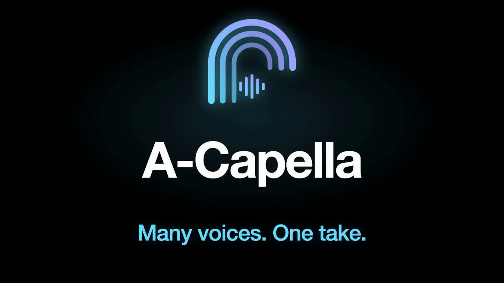

# A-Capella

A 2-minute film about **A-Capella**, the app I built to turn vocals recorded miles and days apart into one synchronized video. [Watch the video](a-capella/a-capella-keynote.mp4) · [Source code](https://github.com/boenchen1112/A-Capella)

---

# About me

- 🔭 I’m currently working on a VR project through Unity
- 🌱 I’m currently learning Python deep learning
- 👯 I’m looking to collaborate on FRC robot code
- 🤔 I’m looking for help with music/coding-related skills
- 💬 Ask me about Japanese anime
- 📫 Reach me through email
- 😄 Pronouns: he/him
- ⚡ Fun fact: I can play a song through piano after listening to it three times (try me)